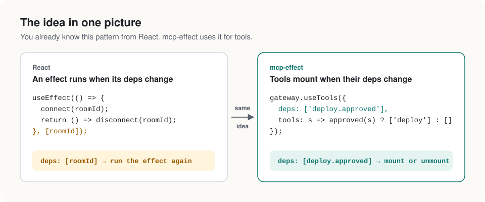
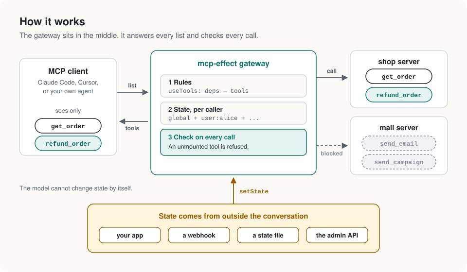
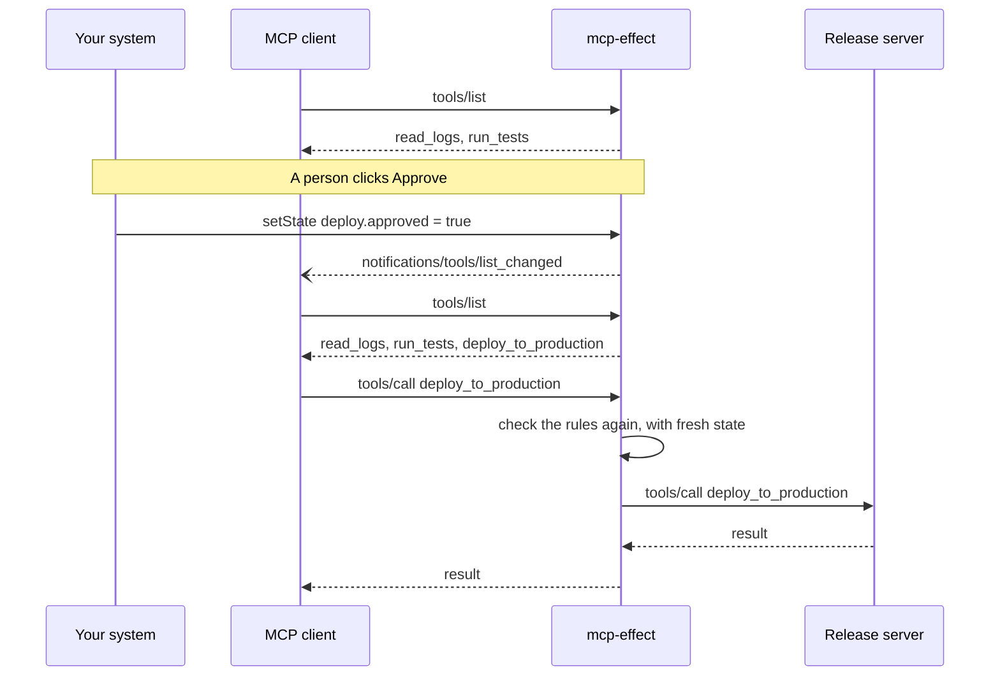

# mcp-effect

**`useEffect` for MCP tools.** A small gateway that makes risky tools exist only when your system says so.

[](https://github.com/lilyanAhmetoglu/mcp-effect/actions/workflows/ci.yml)
[](LICENSE)


## The problem

An agent with MCP sees **every tool, all the time**.

Some tools are harmless, like "read the logs". Some are risky, like "deploy to production" or "send money".

Today we protect the risky ones with a prompt: _"Only deploy after a person approved."_ Then we hope the agent listens.

- The agent can still call the tool at the wrong moment.
- A prompt injection can call it too.
- A prompt is not a rule. Nothing enforces it.

## The idea

In `mcp-effect`, **your system decides which tools exist**. The agent still thinks and decides. But it can only reach the tools that fit the current state.

You write a rule like a React effect. It has dependencies. When they change, the rule runs again.
The result of the rule is the list of tools that exist right now.



```ts
gateway.useTools({
    deps: ['deploy.approved'],
    tools: state => (getPath(state, 'deploy.approved') === true ? ['release__deploy_to_production'] : [])
});
```

Two things make this a real rule:

1. **The agent cannot change the state.** Only your own code can: an Approve button, a webhook, a database change.
2. **An unmounted tool is refused, not only hidden.** This also holds for a client that still has an old tool list.

### Good uses

| Situation      | Rule                                                            |
| -------------- | --------------------------------------------------------------- |
| Approval       | The deploy tool exists only after a person approved.            |
| Incidents      | Production write tools exist only while an incident is open.    |
| Workflow stage | The transfer tool exists only after the identity check is done. |
| Release freeze | All write tools disappear during a freeze.                      |
| Plans          | Pro customers get the reporting tools. Free customers do not.   |

A nice side effect: the agent sees fewer tools. That means less context and fewer wrong picks.

### When you do not need this

- **The step is always automatic.** If a failed payment should always be refunded, use a webhook. You do not need an agent for that.
- **You only want to save tokens.** Tool search does that well, and it needs no rules.

`mcp-effect` is for the case in between: you need the agent's judgment, but a risky tool should only be there at the right moment.

## How it works



1. Your MCP client connects to `mcp-effect` instead of connecting to each server.
2. `mcp-effect` connects to your real MCP servers ("upstreams").
3. You write rules: "when the state looks like this, mount these tools".
4. Your own code changes the state. The model cannot.
5. On every `tools/list` and every `tools/call`, the gateway checks the rules against fresh state.



## Try it in one minute

```bash
git clone https://github.com/lilyanAhmetoglu/mcp-effect.git
cd mcp-effect
npm install
npm run example
```

You will see this. It is the real output of [`examples/library.mjs`](examples/library.mjs):

```text
1. not approved yet        -> read_logs, run_tests
2. deploy before approval  -> refused: Unknown tool: deploy_to_production
3. a person approved       -> deploy_to_production, read_logs, run_tests
4. deploy after approval   -> Deployed build 42 to production
5. approval is used up     -> read_logs, run_tests
```

## Install

The package is not on npm yet. Install it from GitHub:

```bash
npm install github:lilyanAhmetoglu/mcp-effect
```

You need Node.js 22 or newer.

## Use it without writing code

You do not need TypeScript. Write one JSON file and run the command.
This works with an agent written in **any language**, because the gateway is its own process.

`gateway.json`:

```json
{
    "upstreams": {
        "release": { "command": "node", "args": ["./release-server.mjs"] }
    },
    "always": ["release__read_logs", "release__run_tests"],
    "rules": [
        {
            "name": "approved-deploy",
            "when": { "deploy.approved": true },
            "tools": ["release__deploy_to_production"],
            "hint": "The deploy tool appears after a person has approved the release."
        }
    ],
    "state": { "file": "./state.json" }
}
```

`state.json`:

```json
{ "global": { "deploy": { "approved": false } }, "scopes": {} }
```

Then point your MCP client at the gateway. For a client that takes `command` and `args`:

```json
{
    "mcpServers": {
        "release": { "command": "npx", "args": ["mcp-effect", "/full/path/to/gateway.json"] }
    }
}
```

Now change `state.json` from any program, in any language. The tools follow.
A working copy of these files is in [`examples/release`](examples/release).

See the [config reference](docs/config.md) for every field, the HTTP mode, and the state API.

### More examples

| Example                                            | What it shows                                                        |
| -------------------------------------------------- | -------------------------------------------------------------------- |
| [`examples/release`](examples/release)             | A deploy tool that needs approval. Config file and state file.       |
| [`examples/multi-user`](examples/multi-user)       | Two callers over HTTP. Each has their own state and their own tools. |
| [`examples/python-client`](examples/python-client) | The gateway driven from Python, over stdio and over HTTP.            |
| [`examples/library.mjs`](examples/library.mjs)     | The library, in one file.                                            |

## Use it as a library

```ts
import { createGateway, getPath } from 'mcp-effect';

const gateway = createGateway({
    always: ['release__read_logs', 'release__run_tests'],
    // Who is calling? Build this from verified auth only.
    scope: ({ authInfo }) => authInfo?.clientId
});

// Put a real MCP server behind the gateway. Its tools are named release__<tool>.
await gateway.upstream('release', { command: 'node', args: ['./release-server.mjs'] });

// The rule. Read it like useEffect.
gateway.useTools({
    deps: ['deploy.approved'],
    tools: state => (getPath(state, 'deploy.approved') === true ? ['release__deploy_to_production'] : []),
    hint: 'The deploy tool appears after a person has approved the release.'
});

// Serve it. Pick one.
gateway.stdio(); // for desktop clients
const handler = gateway.http(); // handler.fetch(request, { authInfo }) for servers

// Later, from your own code (an Approve button, a webhook, a database trigger):
await gateway.setState({ deploy: { approved: true } }, { scope: 'team:web' });
```

### Rules

A rule can be a function or plain data.

```ts
// A function. `deps` works like the useEffect dependency array:
// the function runs again only when one of these state values changes.
gateway.useTools({
    deps: ['plan'],
    tools: state => (state.plan === 'pro' ? ['reports__*'] : [])
});

// Plain data. The deps are read from the condition for you.
gateway.useTools({
    when: { plan: { in: ['pro', 'team'] }, 'account.frozen': { ne: true } },
    tools: ['reports__*']
});
```

- `*` is a wildcard. `release__*` means every tool of the `release` upstream.
- Operators: `eq`, `ne`, `in`, `nin`, `gt`, `gte`, `lt`, `lte`, `exists`, `contains`.
- Combine conditions with `all`, `any` and `not`.
- If a rule throws an error, it mounts **nothing**. The gateway fails closed.

### State and scopes

State is a plain JSON object. There is one **global** state, and one state per **scope**.

A scope is a caller: a user, a team, a tenant, an API key. A caller sees the global state with their own state on top.

```ts
await gateway.setState({ freeze: true }); // everyone
await gateway.setState({ deploy: { approved: true } }, { scope: 'team:web' }); // only the web team
await gateway.setState({ deploy: null }, { scope: 'team:web' }); // null deletes a key
```

One team never sees tools that are mounted for another team. It cannot call them either.

### Hints

The model cannot ask for a tool it has never heard of. Give each rule a short `hint`.
The gateway puts all hints into the server instructions, so the model knows what can appear.

### Changes

```ts
gateway.on('change', ({ scope, mounted, unmounted }) => {
    console.log(scope, 'mounted', mounted, 'unmounted', unmounted);
});
```

Clients that subscribed get `notifications/tools/list_changed`. Many state writes in a short time become one notification.

A changing tool list can break prompt caching in the client. So this fits state that changes sometimes, like an approval. It does not fit state that changes every few seconds.

## Why state must live outside the conversation

The MCP spec from 2026-07-28 says the tool list **must not** change per connection, and must not change as a side effect of another request on that connection.
So the old trick "call `login`, then new tools appear" is no longer allowed.

The spec still allows two things, and `mcp-effect` is built on exactly these:

| Allowed by the spec                                  | In mcp-effect                |
| ---------------------------------------------------- | ---------------------------- |
| The list changes for everyone, from an outside event | Global state                 |
| The list differs by the caller's authorization       | Scopes, from verified `auth` |

This is also why there is no tool that lets the model change state. If the model could flip the state, the rule would protect nothing.

Read more in [docs/design.md](docs/design.md).

## What is tested

`npm test` runs 89 tests. They use the official MCP SDK client against a real gateway.

- Both protocol versions: 2026-07-28 and the older 2025 handshake.
- Both transports: stdio and HTTP.
- A real upstream MCP server in a child process, behind the built `mcp-effect` command.
- Call-time checks: unmounted tools, old tool lists, and one scope trying to use another scope's tools.
- The HTTP mode: tokens, the state API, body size limits, and the `Host` header guard.
- Scale: 5 000 tools, 300 rules and 2 000 scopes.

In our own test run, the first `tools/list` of a scope took about 0.5 ms, and later ones about 0.1 ms. Your numbers will differ.

Three other clients were also checked against the built command:

| Client                       | What was checked                                                             |
| ---------------------------- | ---------------------------------------------------------------------------- |
| Official Python MCP SDK      | Listing, calling, refusals, notifications, two users over HTTP. Runs in CI.  |
| MCP Inspector (command line) | Listing and calling, with the state file in both positions.                  |
| Claude Code                  | `claude mcp add` and the connection health check. No model conversation yet. |

It has not been tested with every MCP client. If your client behaves differently, please [open an issue](https://github.com/lilyanAhmetoglu/mcp-effect/issues).

## Running many copies

- The HTTP handler keeps nothing between requests. You can run many copies behind a load balancer.
- State lives behind a small `StateStore` interface (`get`, `set`, `subscribe`). The built-in store is in memory. For many processes, write a store over Redis or Postgres.
- Notifications use the SDK's `ServerEventBus`. Pass your own bus to `gateway.http({ bus })` to reach clients on other processes.

Details are in [docs/design.md](docs/design.md#running-many-copies).

## How this is different

Other tools are close, and they are good. Pick the one that fits.

| Tool                                                                                  | Who decides which tools exist?                       |
| ------------------------------------------------------------------------------------- | ---------------------------------------------------- |
| Tool search and "progressive disclosure" gateways                                     | The model, by searching                              |
| [FastMCP](https://gofastmcp.com/servers/visibility) visibility                         | Your server code, call by call                       |
| [`@zap-studio/webmcp-react`](https://jsr.io/@zap-studio/webmcp-react) `useWebMCPTool`  | A React component in a browser                       |
| **mcp-effect**                                                                        | Rules over outside state, in front of any MCP server |

## Limits

- Tools only. Prompts and resources are not forwarded yet.
- Upstream tools that ask the user for more input in the middle of a call are not supported yet.
- A notification on HTTP goes to every subscribed client, not only the scope that changed. Each client then gets its own list.
- The built-in store is in memory. State is gone after a restart, unless you use a state file or your own store.
- A mounted tool can still be misused. Mounting is a gate, not a review of what the agent does with the tool.

## Roadmap

- A `cleanup` function for rules, like the return value of `useEffect`.
- A Redis state store.
- Resources and prompts.
- `useAgentEffect`: start an agent run when deps change.

## Contributing

Issues and pull requests are welcome. See [CONTRIBUTING.md](CONTRIBUTING.md). Maintainers: see [docs/releasing.md](docs/releasing.md).

## License

[MIT](LICENSE)
