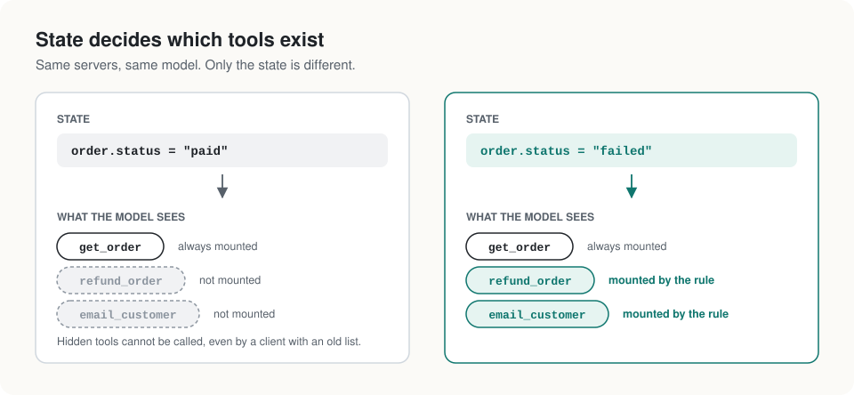
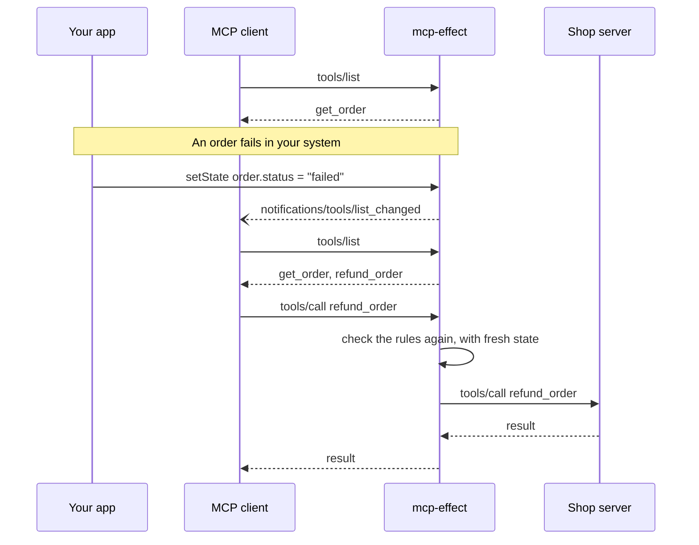

# mcp-effect

**`useEffect` for MCP tools.** A small gateway that mounts tools only when state allows.

[](https://github.com/lilyanAhmetoglu/mcp-effect/actions/workflows/ci.yml)
[](LICENSE)


## The problem

An MCP client shows the model **every tool, all the time**.

- The model can call `refund_order` when no order has failed.
- A prompt injection can call it too.
- Hundreds of tool definitions fill the context and cost money.

Most fixes let the **model** decide what to load ("search for a tool, then use it").
That saves tokens, but it is not a safety rule. The model still decides.

## The idea

In `mcp-effect`, **state decides**. Not the model.

You write a rule like a React effect. It has dependencies. When they change, the rule runs again.
The result of the rule is the list of tools that exist right now.

```ts
gateway.useTools({
    deps: ['order.status'],
    tools: state => (getPath(state, 'order.status') === 'failed' ? ['shop__refund_order'] : [])
});
```



An unmounted tool is not only hidden. **A call to it is refused**, even from a client that still holds an old list.

## How it works


1. Your MCP client connects to `mcp-effect` instead of connecting to each server.
2. `mcp-effect` connects to your real MCP servers ("upstreams").
3. You write rules: "when the state looks like this, mount these tools".
4. Your own code changes the state. The model cannot.
5. On every `tools/list` and every `tools/call`, the gateway checks the rules against fresh state.



## Try it in one minute

```bash
git clone https://github.com/lilyanAhmetoglu/mcp-effect.git
cd mcp-effect
npm install
npm run example
```

You will see this. It is the real output of [`examples/library.mjs`](examples/library.mjs):

```text
1. order is paid      -> get_order
2. refund while paid  -> refused: Unknown tool: refund_order
3. order has failed   -> email_customer, get_order, refund_order
4. refund while failed-> Refunded order 42
5. order is refunded  -> get_order
```

## Install

The package is not on npm yet. Install it from GitHub:

```bash
npm install github:lilyanAhmetoglu/mcp-effect
```

You need Node.js 22 or newer.

## Use it without writing code

You do not need TypeScript. Write one JSON file and run the command.
This works with an agent written in **any language**, because the gateway is its own process.

`gateway.json`:

```json
{
    "upstreams": {
        "shop": { "command": "node", "args": ["./shop-server.mjs"] }
    },
    "always": ["shop__get_order"],
    "rules": [
        {
            "name": "refunds",
            "when": { "order.status": "failed" },
            "tools": ["shop__refund_order", "shop__email_customer"],
            "hint": "Refund and email tools appear when an order has failed."
        }
    ],
    "state": { "file": "./state.json" }
}
```

`state.json`:

```json
{ "global": { "order": { "status": "paid" } }, "scopes": {} }
```

Then point your MCP client at the gateway. For a client that takes `command` and `args`:

```json
{
    "mcpServers": {
        "shop": { "command": "npx", "args": ["mcp-effect", "/full/path/to/gateway.json"] }
    }
}
```

Now change `state.json` from any program, in any language. The tools follow.
A working copy of these files is in [`examples/shop`](examples/shop).

See the [config reference](docs/config.md) for every field, the HTTP mode, and the state API.

## Use it as a library

```ts
import { createGateway, getPath } from 'mcp-effect';

const gateway = createGateway({
    always: ['shop__get_order'],
    // Who is calling? Build this from verified auth only.
    scope: ({ authInfo }) => authInfo?.clientId
});

// Put a real MCP server behind the gateway. Its tools are named shop__<tool>.
await gateway.upstream('shop', { command: 'node', args: ['./shop-server.mjs'] });

// The rule. Read it like useEffect.
gateway.useTools({
    deps: ['order.status'],
    tools: state => (getPath(state, 'order.status') === 'failed' ? ['shop__refund_order'] : []),
    hint: 'Refund tools appear when an order has failed.'
});

// Serve it. Pick one.
gateway.stdio(); // for desktop clients
const handler = gateway.http(); // handler.fetch(request, { authInfo }) for servers

// Later, from your own code (a webhook, a database trigger, a cron job):
await gateway.setState({ order: { status: 'failed' } }, { scope: 'user:alice' });
```

### Rules

A rule can be a function or plain data.

```ts
// A function. `deps` works like the useEffect dependency array:
// the function runs again only when one of these state values changes.
gateway.useTools({
    deps: ['plan', 'order.status'],
    tools: state => (state.plan === 'pro' ? ['reports__*'] : [])
});

// Plain data. The deps are read from the condition for you.
gateway.useTools({
    when: { plan: { in: ['pro', 'team'] }, 'account.frozen': { ne: true } },
    tools: ['reports__*']
});
```

- `*` is a wildcard. `shop__*` means every tool of the `shop` upstream.
- Operators: `eq`, `ne`, `in`, `nin`, `gt`, `gte`, `lt`, `lte`, `exists`, `contains`.
- Combine conditions with `all`, `any` and `not`.
- If a rule throws an error, it mounts **nothing**. The gateway fails closed.

### State and scopes

State is a plain JSON object. There is one **global** state, and one state per **scope**.

A scope is a caller: a user, a tenant, an API key. A caller sees the global state with their own state on top.

```ts
await gateway.setState({ maintenance: true }); // everyone
await gateway.setState({ order: { status: 'failed' } }, { scope: 'user:alice' }); // only Alice
await gateway.setState({ order: null }, { scope: 'user:alice' }); // null deletes a key
```

Alice never sees tools that are mounted for Bob. Bob cannot call them either.

### Hints

The model cannot ask for a tool it has never heard of. Give each rule a short `hint`.
The gateway puts all hints into the server instructions, so the model knows what can appear.

### Changes

```ts
gateway.on('change', ({ scope, mounted, unmounted }) => {
    console.log(scope, 'mounted', mounted, 'unmounted', unmounted);
});
```

Clients that subscribed get `notifications/tools/list_changed`. Many state writes in a short time become one notification.

## Why state must live outside the conversation

The MCP spec from 2026-07-28 says the tool list **must not** change per connection, and must not change as a side effect of another request on that connection.
So the old trick "call `login`, then new tools appear" is no longer allowed.

The spec still allows two things, and `mcp-effect` is built on exactly these:

| Allowed by the spec                                 | In mcp-effect                |
| --------------------------------------------------- | ---------------------------- |
| The list changes for everyone, from an outside event | Global state                 |
| The list differs by the caller's authorization       | Scopes, from verified `auth` |

This is also why there is no tool that lets the model change state. If the model could flip the state, the rule would protect nothing.

Read more in [docs/design.md](docs/design.md).

## What is tested

`npm test` runs 84 tests. They use the official MCP SDK client against a real gateway.

- Both protocol versions: 2026-07-28 and the older 2025 handshake.
- Both transports: stdio and HTTP.
- A real upstream MCP server in a child process, behind the built `mcp-effect` command.
- Call-time checks: unmounted tools, old tool lists, and one scope trying to use another scope's tools.
- The HTTP mode: tokens, the state API, body size limits, and the `Host` header guard.
- Scale: 5 000 tools, 300 rules and 2 000 scopes.

In our own test run, the first `tools/list` of a scope took about 0.5 ms, and later ones about 0.1 ms. Your numbers will differ.

It has not been tested by hand with every MCP client. If your client behaves differently, please [open an issue](https://github.com/lilyanAhmetoglu/mcp-effect/issues).

## Running many copies

- The HTTP handler keeps nothing between requests. You can run many copies behind a load balancer.
- State lives behind a small `StateStore` interface (`get`, `set`, `subscribe`). The built-in store is in memory. For many processes, write a store over Redis or Postgres.
- Notifications use the SDK's `ServerEventBus`. Pass your own bus to `gateway.http({ bus })` to reach clients on other processes.

Details are in [docs/design.md](docs/design.md#running-many-copies).

## How this is different

Other tools are close, and they are good. Pick the one that fits.

| Tool                                                                                   | Who decides which tools exist? |
| -------------------------------------------------------------------------------------- | ------------------------------ |
| Tool search and "progressive disclosure" gateways                                      | The model, by searching        |
| [FastMCP](https://gofastmcp.com/servers/visibility) visibility                          | Your server code, call by call |
| [`@zap-studio/webmcp-react`](https://jsr.io/@zap-studio/webmcp-react) `useWebMCPTool`   | A React component in a browser |
| **mcp-effect**                                                                         | Rules over outside state, in front of any MCP server |

## Limits

- Tools only. Prompts and resources are not forwarded yet.
- Upstream tools that ask the user for more input in the middle of a call are not supported yet.
- A notification on HTTP goes to every subscribed client, not only the scope that changed. Each client then gets its own list.
- The built-in store is in memory. State is gone after a restart, unless you use a state file or your own store.

## Roadmap

- A `cleanup` function for rules, like the return value of `useEffect`.
- A Redis state store.
- Resources and prompts.
- `useAgentEffect`: start an agent run when deps change.

## Contributing

Issues and pull requests are welcome. See [CONTRIBUTING.md](CONTRIBUTING.md).

## License

[MIT](LICENSE)
